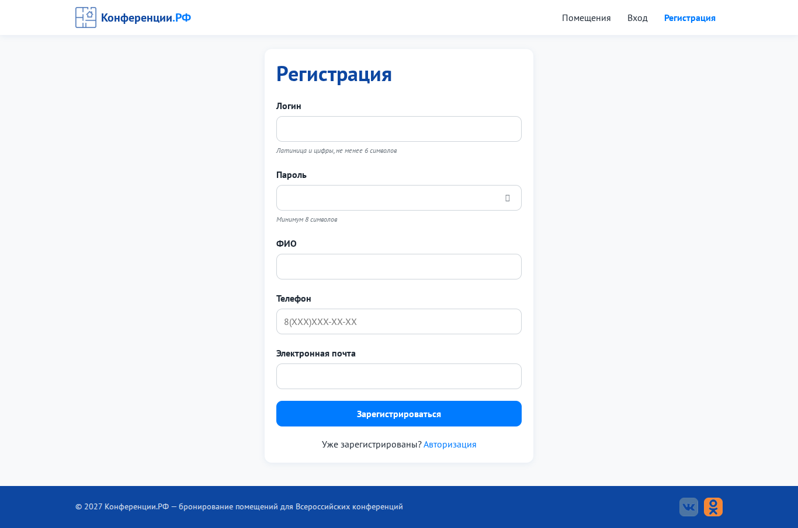
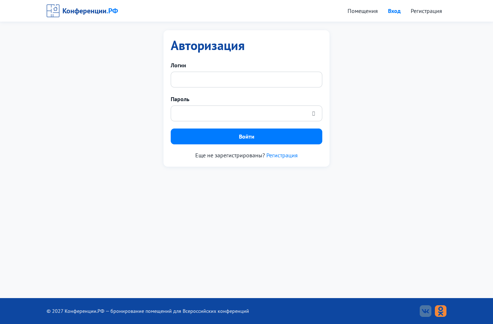
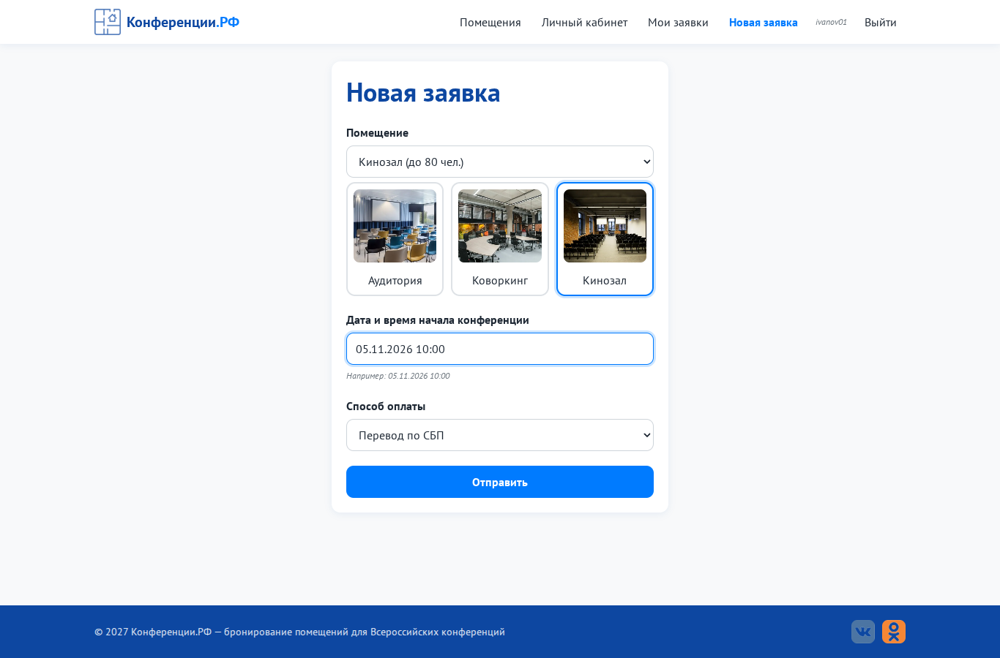
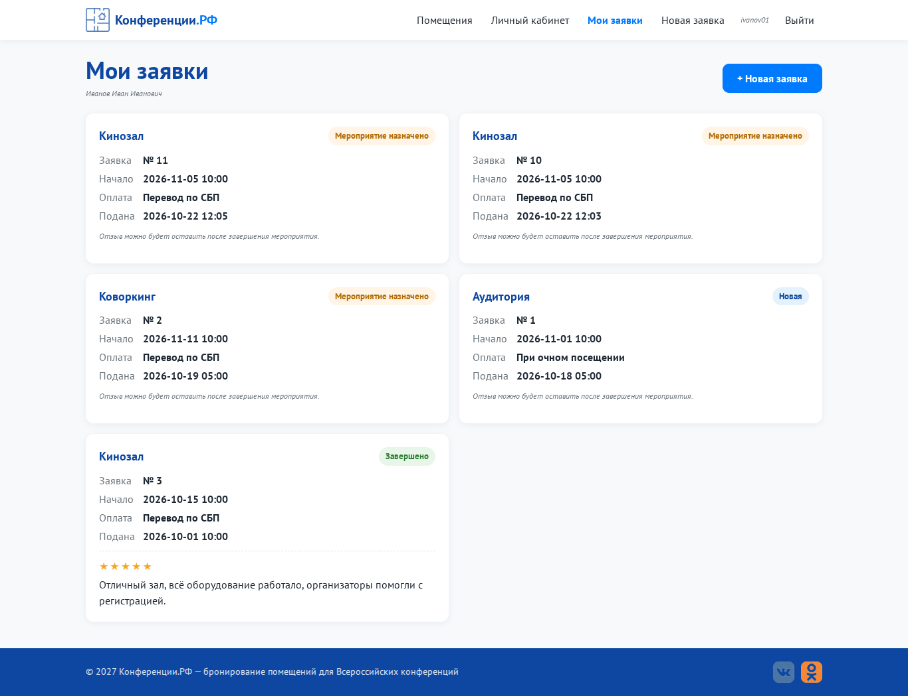
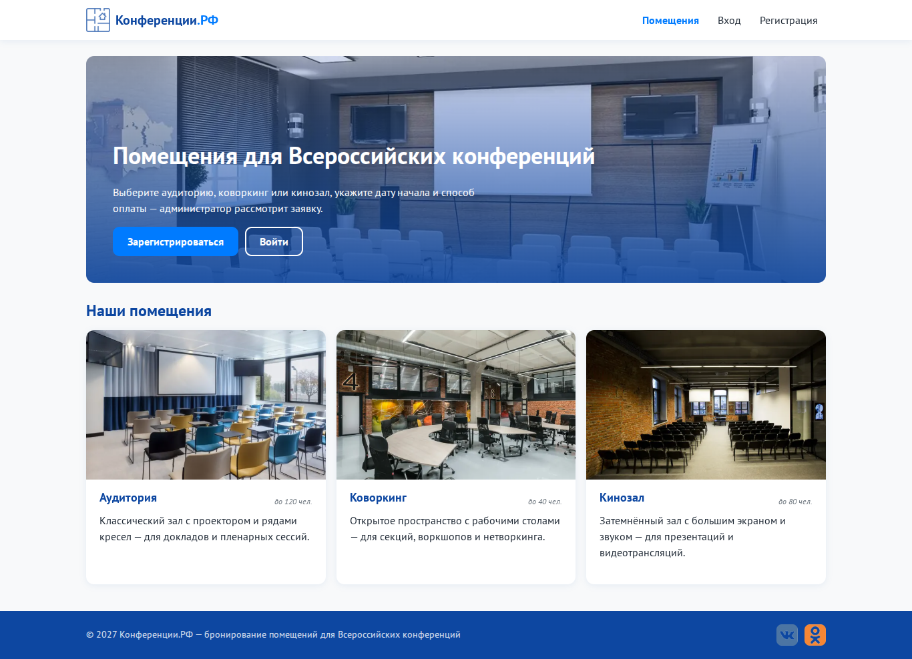

# Практическая работа № 3. Разработка модулей ИС в соответствии с ТЗ

**Цель:** разработать основные модули портала «Конференции.РФ».
**Стек:** Python 3 + Flask (бекенд), SQLite (БД), HTML/CSS/JavaScript (фронтенд). Код лежит в папке [`code/`](code). Папка содержит самостоятельную сборку основных модулей с необходимыми зависимостями безопасности и проверки форм. Расширенная итоговая версия находится в [`ПР11/code`](../ПР11_Веб-приложение_по_ТЗ/code).

## Структура проекта (фронтенд / бекенд / БД)
```
code/
├── backend/                 ← БЕКЕНД
│   ├── app.py               точка входа, сборка Flask-приложения
│   ├── config.py            настройки
│   ├── database.py          класс Database (Singleton) - слой работы с БД
│   ├── models/              ООП-модели: BaseModel → User, Request, Review, Room, Status, PaymentMethod
│   ├── validators/          класс Validator - серверная валидация
│   ├── security/            декораторы доступа, CSRF, защита входа
│   └── routes/              маршруты (Blueprint): auth, requests, admin, main
├── frontend/                ← ФРОНТЕНД
│   ├── templates/           HTML-шаблоны Jinja2
│   └── static/              css/, js/, img/, fonts/
├── database/                ← БД (файл SQLite создаётся при первом запуске)
├── schema.sql               SQL-скрипт создания таблиц
└── run.py                   запуск: python run.py
```

ПР03 запускается из своей папки `code/`. Зависимости `backend/security/` и `frontend/static/js/validation.js` включены в сборку; их устройство рассматривается в ПР04 и ПР09.

## Реализованные модули

| Модуль | Страница / API | Файлы |
|---|---|---|
| **Регистрация** | `/register`, `POST /api/register` | `routes/auth_routes.py`, `models/user.py`, `validators/validators.py`, `templates/register.html`, `static/js/register.js` |
| **Авторизация** | `/login`, `POST /api/login` | `routes/auth_routes.py`, `templates/login.html`, `static/js/login.js` |
| **Создание заявки** | `/requests/new`, `POST /api/requests` | `routes/request_routes.py`, `models/request.py`, `templates/create_request.html`, `static/js/request.js` |
| **Просмотр заявок** | `/dashboard`, `GET /api/requests` | `routes/request_routes.py`, `templates/dashboard.html` |
| **Личный кабинет** | `/profile` | `routes/request_routes.py`, `Request.summary_for_user()`, `templates/profile.html` |
| **Панель администратора** | `/admin`, `GET /api/admin/requests`, `PATCH /api/admin/requests/<id>/status` | `routes/admin_routes.py`, `templates/admin.html`, `static/js/admin.js` |

### Валидация при регистрации (как в ТЗ)
| Поле | Правило | Где проверяется |
|---|---|---|
| Логин | латиница и цифры, ≥ 6 символов, **уникальный** | `Validator.login` + `User.validate()` (запрос в БД) |
| Пароль | ≥ 8 символов | `Validator.password` |
| ФИО | кириллица и пробелы | `Validator.fio` |
| Телефон | `8(XXX)XXX-XX-XX` | `Validator.phone` + маска ввода в `register.js` |
| E-mail | формат почты | `Validator.email` |

## Применение ООП
| Принцип | Где |
|---|---|
| **Инкапсуляция** | `Database` скрывает подключение и SQL; модели дают методы `register()`, `create()`, `list_for_user()` |
| **Наследование** | `BaseModel` → `User`, `Request`, `Review`, `Room`, `Status`, `PaymentMethod` (общие `get_by_id`, `get_all`, `to_dict`) |
| **Полиморфизм** | метод `validate()` переопределён в `User` и `Request` |
| **Singleton** | `Database` создаётся один раз на приложение |

## Взаимодействие фронтенда и бекенда
Браузер отправляет JSON через `fetch` (функция `App.api` в `static/js/common.js`). Flask-маршрут вызывает метод модели, модель обращается к `Database`, и в ответ уходит JSON (`{errors: {...}}` или `{message, redirect}`).

## Как запустить
```bash
cd ПР03_Разработка_модулей_ИС_по_ТЗ/code
python -m venv venv
venv\Scripts\activate            # Windows  (Linux: source venv/bin/activate)
pip install -r requirements.txt
python seed_demo.py              # тестовые данные (необязательно)
python run.py                    # открыть http://127.0.0.1:5000
```
Администратор: **Conf2027 / Demo77**. Тестовый участник: **ivanov01 / Password1**.

## Принтскрины
| | |
|---|---|
|  |  |
|  |  |


