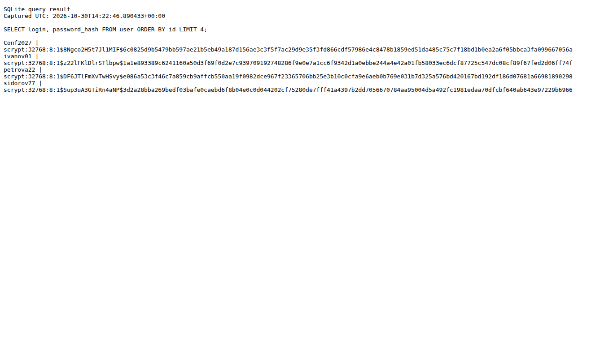
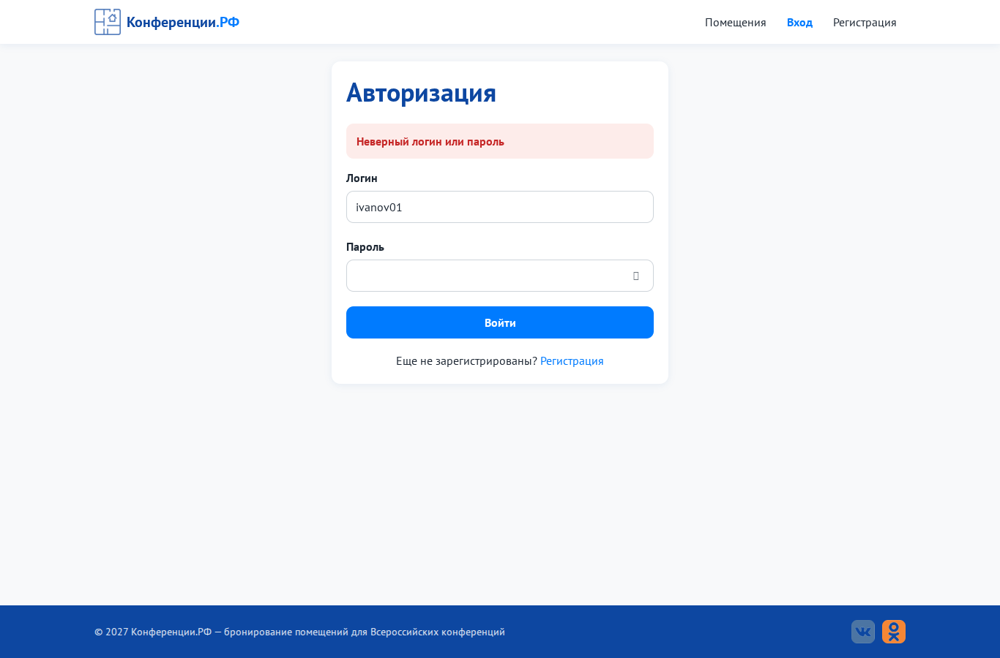
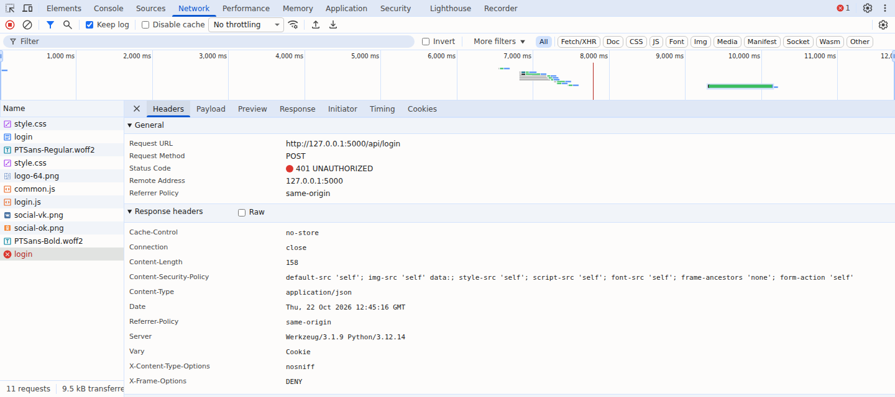

# Практическая работа № 4. Разработка подсистем безопасности ИС

**Цель:** обеспечить безопасность портала «Конференции.РФ».

Папка `code/` содержит изменения этой практики, а не самостоятельную сборку. Ниже пути к механизмам указаны относительно [итогового приложения ПР11](../ПР11_Веб-приложение_по_ТЗ/code).

## Что реализовано

| № | Механизм | Как сделано | Файл |
|---|---|---|---|
| 1 | **Хеширование паролей** | `werkzeug.security.generate_password_hash` (scrypt с солью); проверка через `check_password_hash`. Открытый пароль в БД не попадает | [`backend/models/user.py`](../ПР11_Веб-приложение_по_ТЗ/code/backend/models/user.py) |
| 2 | **Защита от SQL-инъекций** | все запросы только с плейсхолдерами `?` (подготовленные выражения): `db.execute('... WHERE login = ?', (login,))`. Даже фильтры админки собираются из плейсхолдеров | [`backend/database.py`](../ПР11_Веб-приложение_по_ТЗ/code/backend/database.py), [`backend/models/`](../ПР11_Веб-приложение_по_ТЗ/code/backend/models) |
| 3 | **Разграничение прав** | декораторы: `@participant_required` (участник), `@admin_required` (администратор), `@guest_only` (вход и регистрация только для гостя). Гость видит только главную | [`backend/security/decorators.py`](../ПР11_Веб-приложение_по_ТЗ/code/backend/security/decorators.py) |
| 4 | **Валидация на сервере и клиенте** | сервер: класс `Validator`; клиент: `Rules` в `validation.js` с теми же правилами и выводом ошибок под полем | [`backend/validators/validators.py`](../ПР11_Веб-приложение_по_ТЗ/code/backend/validators/validators.py), [`frontend/static/js/validation.js`](../ПР11_Веб-приложение_по_ТЗ/code/frontend/static/js/validation.js) |
| 5 | **Защита сессий и cookies** | cookie `HttpOnly` (недоступна из JS), `SameSite=Lax`, `Secure` по HTTPS, срок жизни 2 ч; `session.clear()` при входе (защита от фиксации сессии); случайный `SECRET_KEY` | [`backend/config.py`](../ПР11_Веб-приложение_по_ТЗ/code/backend/config.py), [`backend/routes/auth_routes.py`](../ПР11_Веб-приложение_по_ТЗ/code/backend/routes/auth_routes.py) |
| 6 | **Защита от CSRF** | токен в сессии и в `<meta name="csrf-token">`, обязательный заголовок `X-CSRF-Token` для POST/PATCH; сравнение через `hmac.compare_digest` | [`backend/security/protection.py`](../ПР11_Веб-приложение_по_ТЗ/code/backend/security/protection.py) |
| 7 | **Защита от подбора пароля** | после 5 неверных попыток вход по логину блокируется на 5 минут (ответ 429) | [`LoginThrottle`](../ПР11_Веб-приложение_по_ТЗ/code/backend/security/protection.py) |
| 8 | **Защита от XSS** | Jinja2 экранирует вывод; в JS текст вставляется только через `textContent`; заголовок `Content-Security-Policy` запрещает inline-скрипты | [`frontend/templates/`](../ПР11_Веб-приложение_по_ТЗ/code/frontend/templates), [`frontend/static/js/admin.js`](../ПР11_Веб-приложение_по_ТЗ/code/frontend/static/js/admin.js), [`backend/security/protection.py`](../ПР11_Веб-приложение_по_ТЗ/code/backend/security/protection.py) |
| 9 | **Защитные заголовки** | `X-Frame-Options: DENY`, `X-Content-Type-Options: nosniff`, `Referrer-Policy`, `Cache-Control: no-store` для API | [`backend/security/protection.py`](../ПР11_Веб-приложение_по_ТЗ/code/backend/security/protection.py) |

## Матрица доступа

| Страница / действие | Гость | Участник | Администратор |
|---|:-:|:-:|:-:|
| Главная (помещения) | ✅ | ✅ | ✅ |
| Регистрация, вход | ✅ | ↪ в кабинет | ↪ в панель |
| Создать заявку, мои заявки, отзыв | ↪ вход (401) | ✅ | ↪ панель (403) |
| Все заявки, смена статуса | ↪ вход (401) | ⛔ 403 | ✅ |

## Проверка (автотесты)
Тесты в [`code/tests/test_app.py`](code/tests/test_app.py) проверяют безопасность:

| Тест | Что проверяет |
|---|---|
| `test_password_is_hashed` | в БД хранится хеш `scrypt:...`, а не пароль |
| `test_sql_injection_login` | вход с логином `' OR '1'='1` отклоняется (401) |
| `test_csrf_required` | POST без токена → 400 |
| `test_login_bruteforce_lock` | после 5 ошибок вход блокируется → 429 |
| `test_guest_cannot_open_dashboard` | гость → редирект / 401 |
| `test_user_cannot_open_admin` | участник в API админки → 403 |
| `test_security_headers` | есть CSP и X-Frame-Options |

Тесты запускаются из `ПР11_Веб-приложение_по_ТЗ/code`, где лежит приложение целиком:
```
cd ПР11_Веб-приложение_по_ТЗ/code
python -m pytest -q tests
```

## Материалы проверки

[`data/password_hashes.txt`](data/password_hashes.txt) содержит повторную выборку из временной SQLite-базы. Изображение ниже — снимок этого текстового результата, открытого в браузере. Команда SQL приведена в файле; результат получает модуль `sqlite3`, а не вручную заполненная таблица. Повторный сбор: [`tools/collect_evidence.py`](https://github.com/rainall27/IG_MDK05.03/blob/main/tools/collect_evidence.py) из репозитория тестирования.

## Принтскрины
| Хеши паролей в БД | Ошибка входа |
|---|---|
|  |  |

## Защитные заголовки ответа
На снимке видны Content-Security-Policy, X-Frame-Options, X-Content-Type-Options и Cache-Control.



## Код этой работы
Папка [`code/`](code). Файлы:

- `backend/security/__init__.py`
- [`backend/security/decorators.py`](../ПР11_Веб-приложение_по_ТЗ/code/backend/security/decorators.py)
- [`backend/security/protection.py`](../ПР11_Веб-приложение_по_ТЗ/code/backend/security/protection.py)
- `backend/config.py`
- `backend/database.py`
- `backend/models/user.py`
- `backend/routes/auth_routes.py`
- `tests/__init__.py`
- `tests/test_app.py`
