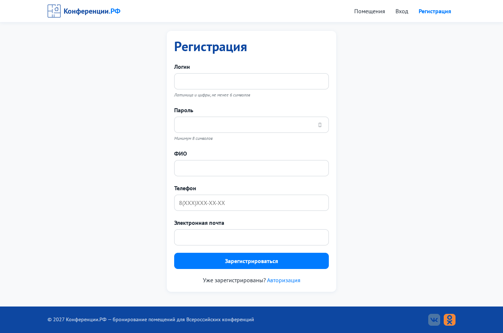
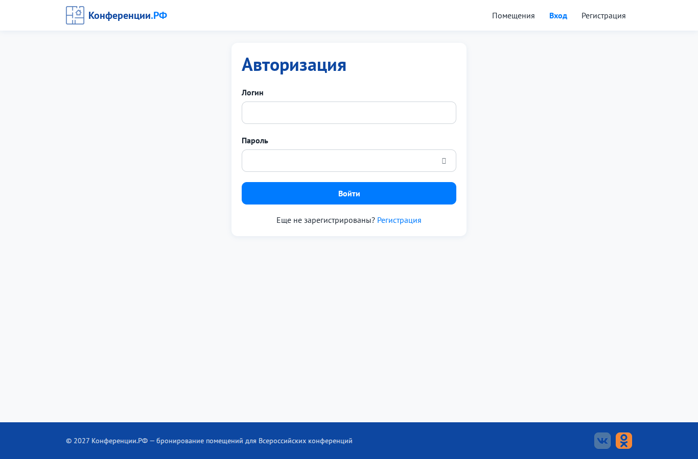
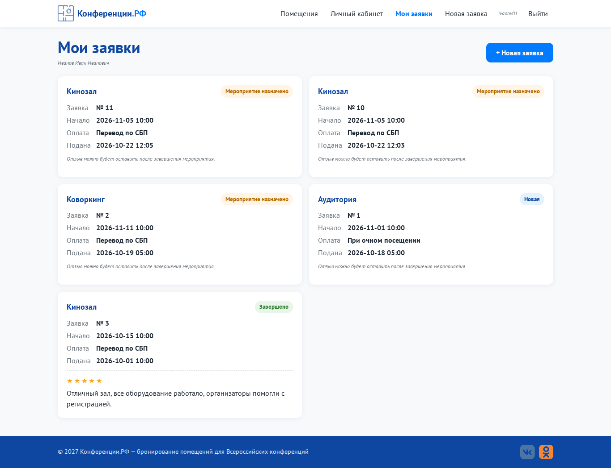
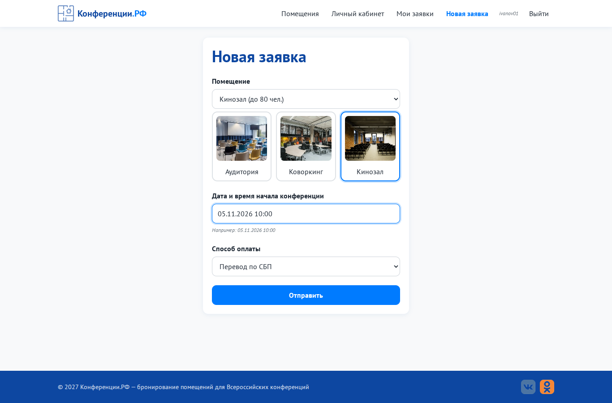
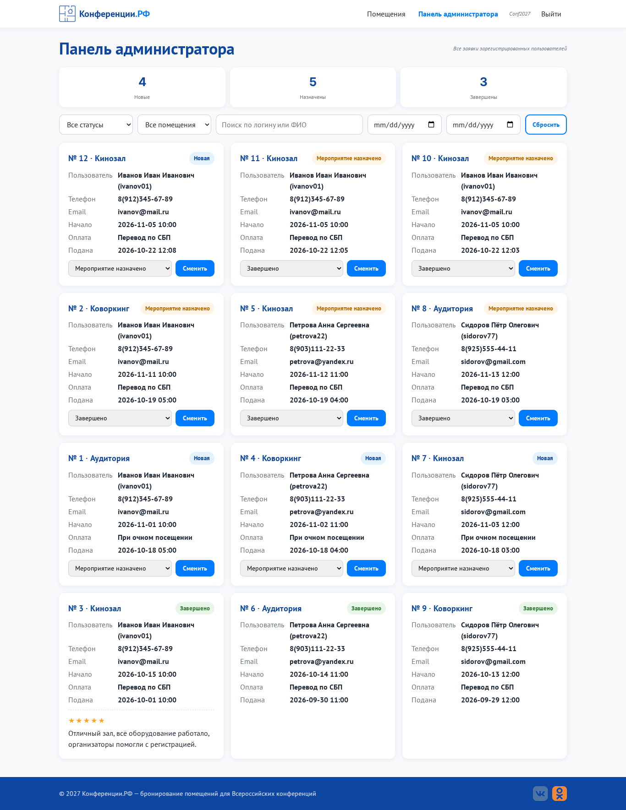
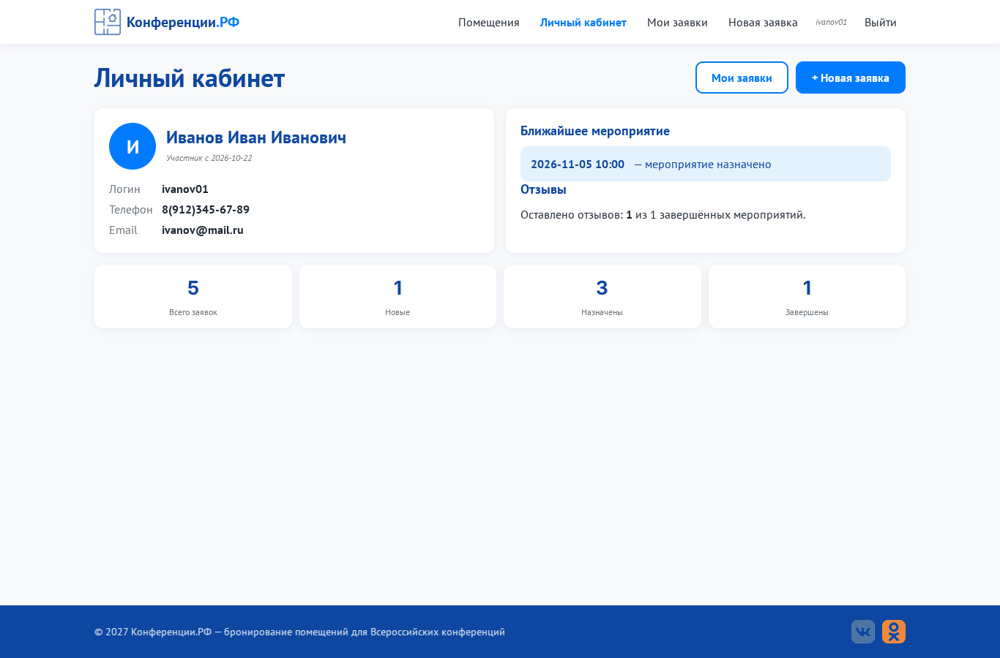
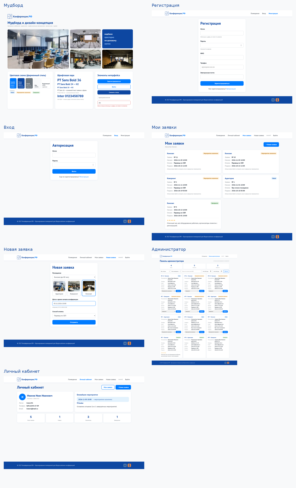

# Практическая работа № 7. Разработка дизайн-концепций веб-приложений

**Цель:** разработать дизайн-концепцию портала «Конференции.РФ» в соответствии с корпоративным стилем заказчика.

| Файл | Что это |
|---|---|
| `img/moodboard.png` | мудборд: фото пространств, ключевые слова, палитра, шрифты, UI-элементы |
| `code/moodboard.html` + `code/assets/` | исходник мудборда (HTML и CSS, открывается в браузере) |
| `img/maket_1…6_*.png` | **6 дизайн-макетов страниц**: регистрация, авторизация, просмотр заявок, создание заявки, панель администратора, личный кабинет (ПК, 1366 px) |
| `img/00_overview_moodboard_and_mockups.png` | принтскрин результата |

## 1. Мудборд
Настроение - **надёжность, уверенность, деловое пространство, светлые залы**. На мудборде фотографии аудитории, коворкинга и кинозала из медиаматериалов к заданию (приложение 1 к КИМ).

## 2. Цветовая схема (из «Руководства по стилю»)
| Цвет | HEX | Роль в интерфейсе |
|---|---|---|
| Голубой | `#007bff` | кнопки, ссылки, активный пункт меню, фокус |
| Тёмно-синий | `#0d47a1` | заголовки, подвал, логотип, градиент на баннере, hover кнопок |
| Серый | `#6c757d` | подсказки, подписи в карточках |
| Фон | `#f8f9fa` | фон страниц |
| Выделяющий | `#ffffff` | карточки, формы, шапка |

Дополнительные служебные цвета (в тон палитре) для статусов и ошибок: голубой бейдж «Новая», оранжевый «Мероприятие назначено» `#b26a00`, зелёный «Завершено» `#2e7d32`, красный для ошибок `#c62828`.

## 3. Шрифтовая пара
| Шрифт | Где | Размеры |
|---|---|---|
| **PT Sans** (основной, по стилю заказчика) | весь текст | H1 36 / H2 24 / H3 18 px Bold; текст 16 px; подсказки 12 px Italic |
| **Inter Bold** (акцентный, из приложения к заданию) | только цифры счётчиков в панели администратора | 26 px |

Пара работает потому, что PT Sans - гуманистический гротеск с хорошей кириллицей, а Inter - геометричный гротеск с ровными табличными цифрами. Шрифты контрастируют только в цифрах и не спорят друг с другом в тексте.

## 4. Макеты и соответствие стилю
- Карточный интерфейс: белые карточки на фоне `#f8f9fa`, скругление 12 px, мягкая синяя тень.
- Баннер главной: фото зала с градиентом тёмно-синего цвета, чтобы белый текст хорошо читался.
- Логотип: иконка плана помещения из медиаматериалов, перекрашенная в фирменный `#0d47a1`.
- Кнопки: основная `#007bff`, при наведении `#0d47a1`; второстепенная - контурная.

### 6 макетов страниц
| 1. Регистрация | 2. Авторизация | 3. Просмотр заявок |
|---|---|---|
|  |  |  |

| 4. Создание заявки | 5. Панель администратора | 6. Личный кабинет |
|---|---|---|
|  |  |  |

