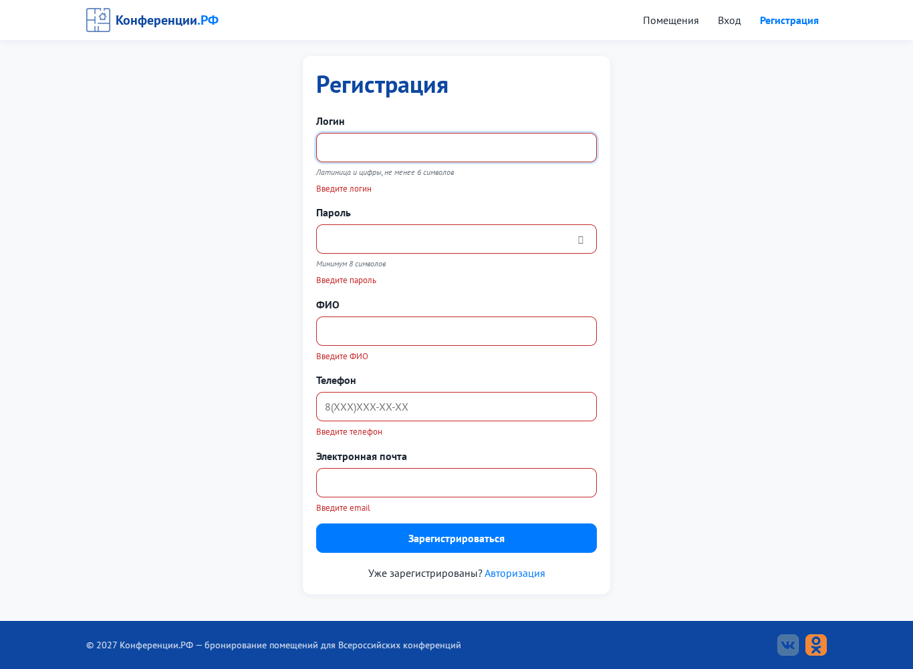
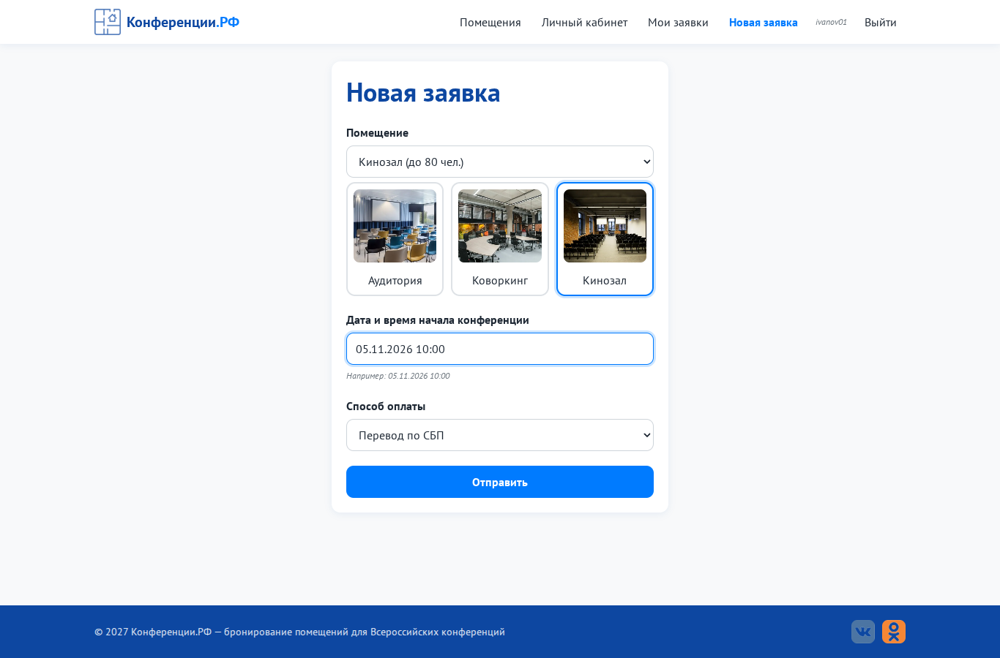
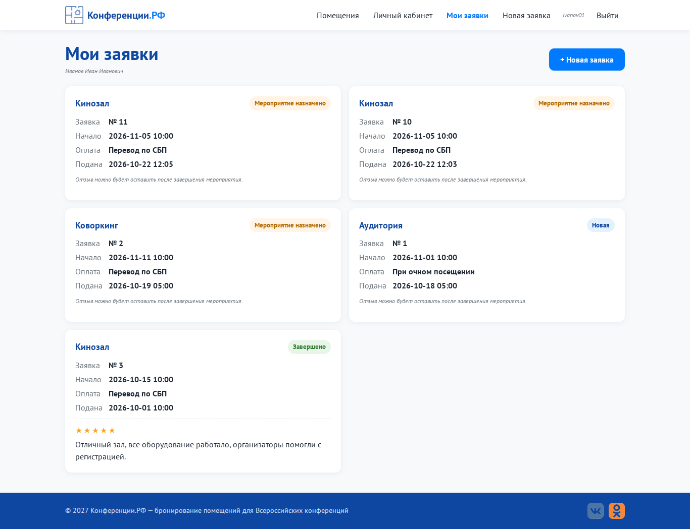
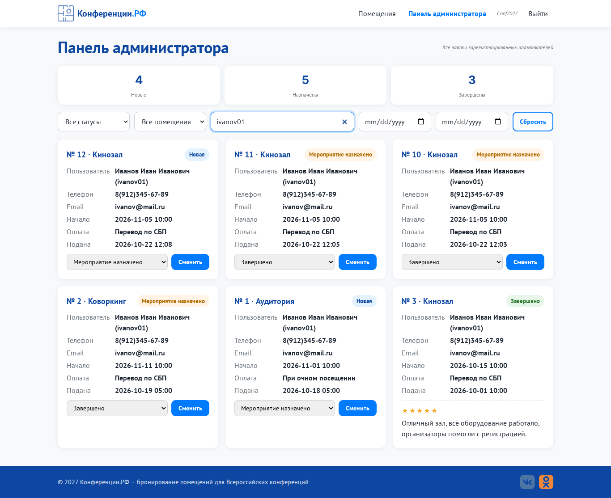

# Практическая работа № 9. Улучшение форм и интерфейса

**Цель:** улучшить формы и интерфейс портала.

| № | Требование | Что сделано | Файлы |
|---|---|---|---|
| 1 | **Валидация с выводом ошибок на странице** | под каждым полем блок `.field__error`; поле с ошибкой подсвечивается красным и «встряхивается»; проверка при уходе с поля (blur) и при отправке; общая ошибка (например «Неверный логин или пароль») выводится над формой; ошибки сервера (`422 {errors}`) показываются в тех же местах | `static/js/validation.js`, `static/js/common.js` (`showErrors`), `register.html`, `login.html` |
| 2 | **Выпадающие списки вместо текстовых полей** | помещение выбирается из `<select>` и дублируется карточками с фото (синхронизированы); способ оплаты - `<select>`: «При очном посещении» / «Перевод по СБП»; дата и время вводятся в формате `ДД.ММ.ГГГГ ЧЧ:ММ`; прошедшие и несуществующие даты отклоняются | `create_request.html`, `static/js/request.js` |
| 3 | **Фильтрация и карточки в панели администратора** | фильтры по статусу, помещению, диапазону дат начала и поиск по логину или ФИО (с задержкой 300 мс); заявки показаны карточками с контактами и бейджем статуса; счётчики по статусам | `admin.html`, `static/js/admin.js`, `Request.list_filtered()` |
| 4 | **Отзыв только после завершения мероприятия** | форма отзыва выводится только у заявок со статусом «Завершено»; сервер дополнительно проверяет статус и владельца (иначе 409) и не даёт оставить второй отзыв | `dashboard.html`, `models/review.py` |
| + | Маска телефона | при вводе цифр сама подставляет `8(XXX)XXX-XX-XX` | `static/js/register.js` |

## Примеры поведения форм

1. Пустая регистрация не отправляется: `validateForm` возвращает ошибки пяти полей, `App.showErrors` показывает их под соответствующими полями. После исправления поля `liveValidate` обновляет его состояние.
2. В заявке дата `31.02.2030 10:00` отклоняется как несуществующая, прошедшая дата — как недопустимая. Выбор помещения в карточке синхронизируется с `<select>`. Это проверяется в `frontend/static/js/request.js`.
3. При попытке отправить отзыв для незавершённой заявки сервер возвращает 409. Для завершённой заявки принимается один отзыв; повторный запрос отклоняется. Правило реализовано в `backend/models/review.py` итогового приложения.

## Принтскрины
| Ошибки в форме регистрации | Выпадающие списки и карточки помещений |
|---|---|
|  |  |

| Фильтрация в админке | Отзыв только у завершённых |
|---|---|
|  |  |

## Код этой работы
Папка [`code/`](code). Файлы:

- `frontend/static/js/validation.js`
- `frontend/static/js/common.js`
- `frontend/static/js/register.js`
- `frontend/static/js/request.js`
- `frontend/static/js/admin.js`
- `frontend/templates/register.html`
- `frontend/templates/login.html`
- `frontend/templates/create_request.html`
- `frontend/templates/admin.html`
- `frontend/templates/dashboard.html`
- `backend/models/review.py`

Приложение целиком и запуск: [`ПР11/code`](../ПР11_Веб-приложение_по_ТЗ/code).
