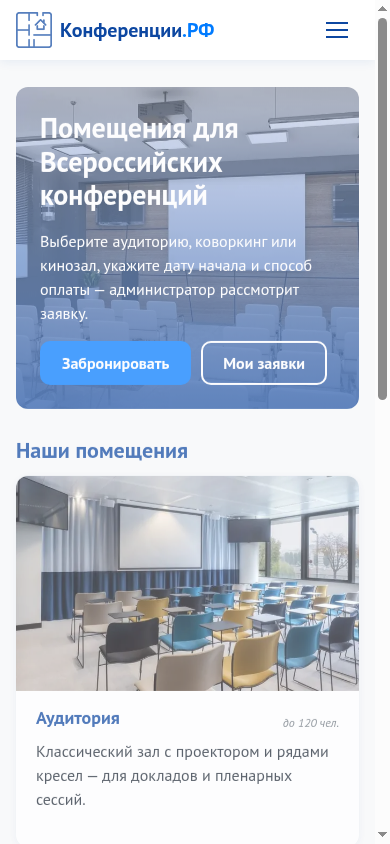
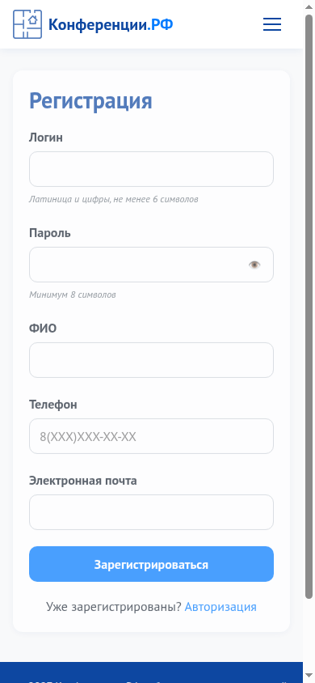
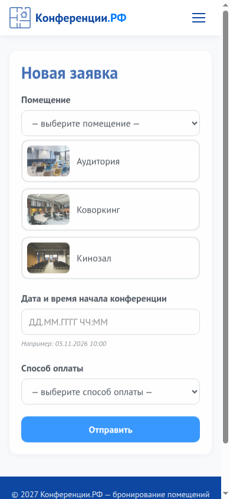
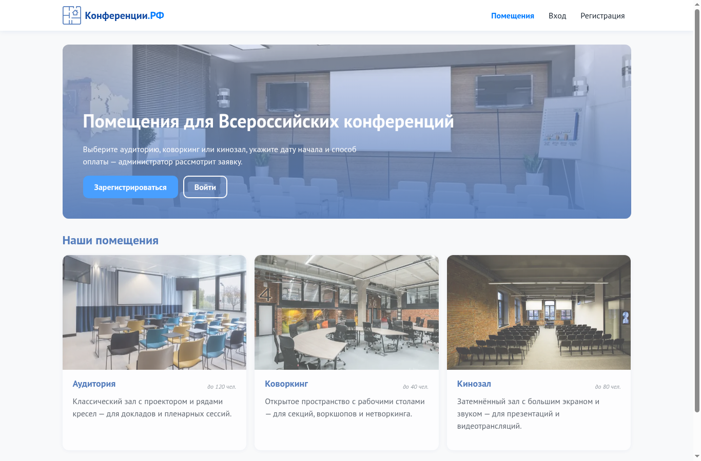
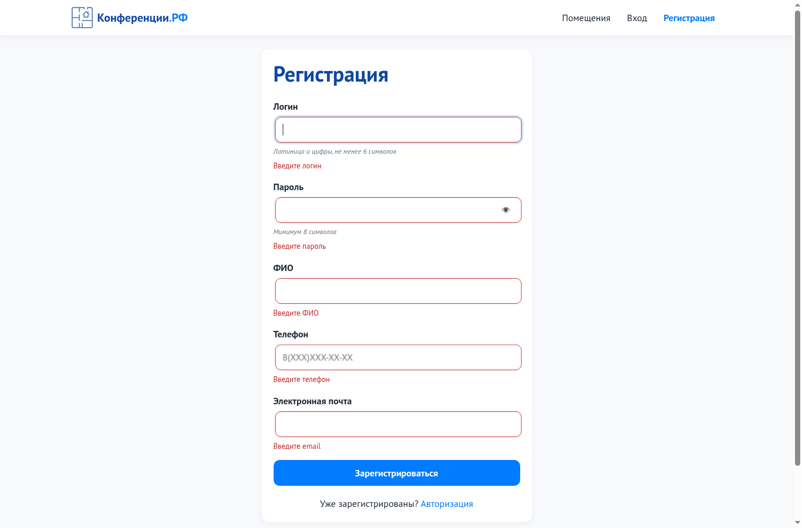
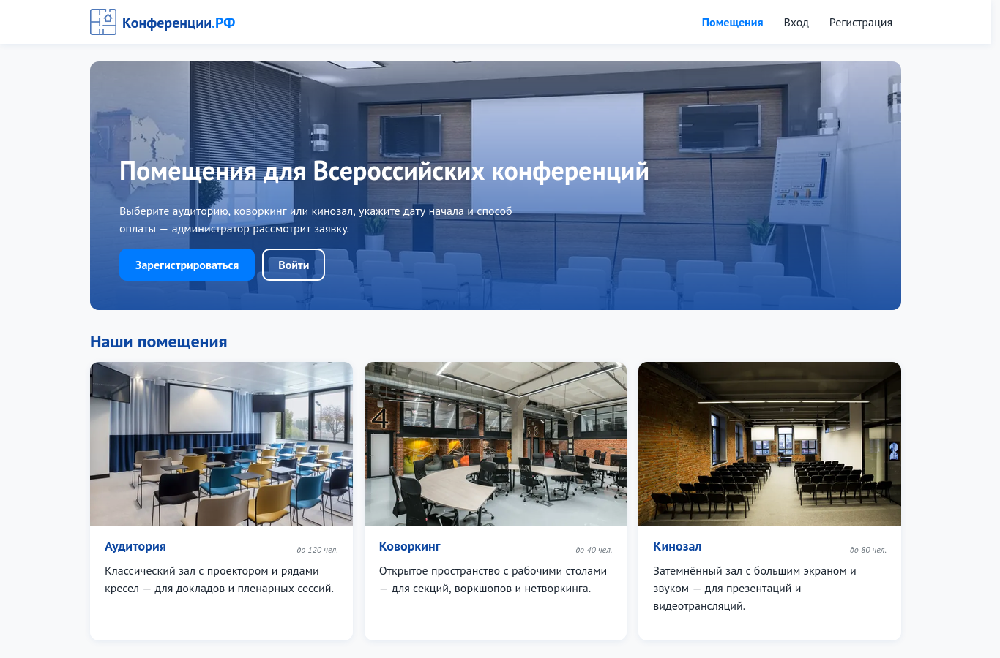
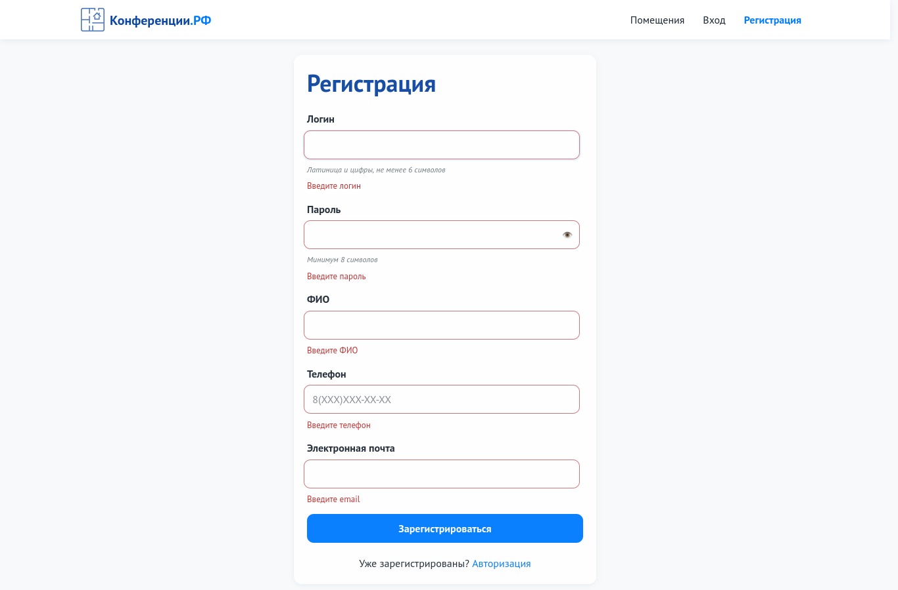
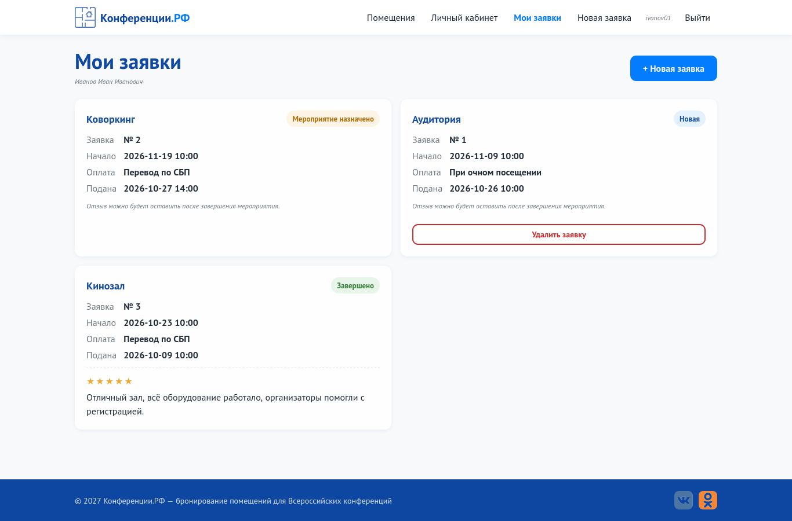
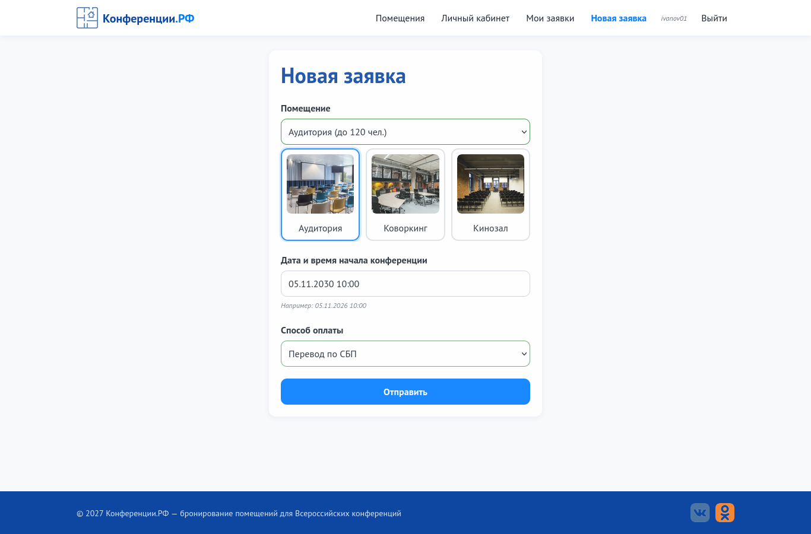

# Практическая работа № 10. Разработка интерфейса пользователя

**Цель:** свёрстать интерфейс портала по техническому заданию.

## Соответствие ТЗ (задание 1 КИМ)
| Страница из ТЗ | Требование | Реализация |
|---|---|---|
| Регистрация | логин, пароль, ФИО, телефон, e-mail, все обязательные | `code/frontend/templates/register.html`, кнопка «Зарегистрироваться» |
| Авторизация | логин и пароль, сообщения об ошибках, ссылка **«Еще не зарегистрированы? Регистрация»** и обратно | `code/frontend/templates/login.html` («Уже зарегистрированы? Авторизация» на странице регистрации) |
| Просмотр заявок | свои заявки и отзыв о мероприятии | `code/frontend/templates/dashboard.html` |
| Формирование заявки | помещение, дата начала, способ оплаты (очно / СБП), кнопка «Отправить» | `code/frontend/templates/create_request.html` |
| Панель администратора | все заявки, смена статуса «Новая» → «Мероприятие назначено» / «Завершено» | `code/frontend/templates/admin.html` |

## Технологии вёрстки
- **HTML5:** семантика (`header`, `nav`, `main`, `section`, `article`, `footer`), `label for` у каждого поля, `alt` у картинок, `aria-*` у меню и рейтинга.
- **CSS3:** CSS-переменные с фирменной палитрой, Grid и Flexbox, медиа-запросы, анимации `@keyframes`. Один файл `code/frontend/static/css/style.css`.
- **JavaScript:** без библиотек, `fetch` + JSON, отдельный файл для каждой страницы.
- **Шаблонизатор Jinja2:** общий каркас `base.html`, страницы наследуют его через ``.

## Адаптивность (390×844)
Вёрстка mobile-first: на смартфоне 1 колонка и меню-бургер, на планшете (768 px) 2 колонки, на ПК (992 px+) 3 колонки и горизонтальное меню.

## Проверка в двух браузерах
Повторная проверка выполнена 30.10.2026 в [GitHub Actions](https://github.com/rainall27/IG_MDK05.03/actions/runs/41071186105) на временной базе данных. Приложение: коммит `ace5c31b61d5d6c937f111fba525e5fff628a78b`.

| Браузер | Область страницы | Проверки |
|---|---|---|
| Chrome 156.0.8078.47 | 1366×900 и 390×844 | главная, 5 ошибок пустой регистрации, вход, заявки, форма даты; на мобильных страницах нет горизонтального переполнения |
| Firefox 158.0.1 | 1366×900 | главная, 5 ошибок пустой регистрации, вход, заявки, выбор помещения, оплаты и ввод даты |

В Chrome в журнале браузера не обнаружено необработанных ошибок JavaScript в проверенных сценариях. В Firefox сбор такого журнала не выполнялся, поэтому вывод об отсутствии исключений для него не делается.

Сценарий проверки: [`code/check_browsers.py`](code/check_browsers.py); фактические версии, дата и измерения: [`code/browser_checks.json`](code/browser_checks.json). Для повторения запустить ПР11, установить Selenium (`pip install selenium`), затем из папки этой практики выполнить:

```text
python code/check_browsers.py --base-url http://127.0.0.1:5000 --output browser-evidence
```

Нужны установленные Chrome и Firefox; Selenium подбирает драйверы. Учётная запись `ivanov01 / Password1` создаётся командой `python seed_demo.py` в ПР11. Проверка ограничена перечисленными сценариями. Selenium-наборы заданий 4 и 5 имеют отдельные отчёты и окружение.

## Мобильная версия 390×844
На главной, в регистрации и форме заявки нет горизонтального переполнения. На мобильной ширине навигация заменена кнопкой меню, блоки перестроены в одну колонку.

| Главная | Регистрация | Новая заявка |
|---|---|---|
|  |  |  |

## Главная в Chromium на ПК


## Валидация в Chromium


## Главная в Firefox


## Валидация в Firefox


## Мои заявки в Firefox


## Форма новой заявки в Firefox


## Код этой работы
Папка [`code/`](code). Файлы:

- `frontend/static/css/style.css`
- `frontend/static/js/common.js`
- `frontend/templates/base.html`
- `frontend/templates/index.html`
- `frontend/templates/register.html`
- `frontend/templates/login.html`
- `frontend/templates/dashboard.html`
- `frontend/templates/create_request.html`
- `frontend/templates/admin.html`
- `frontend/templates/profile.html`
- `frontend/templates/error.html`
- `browser_checks.json`
