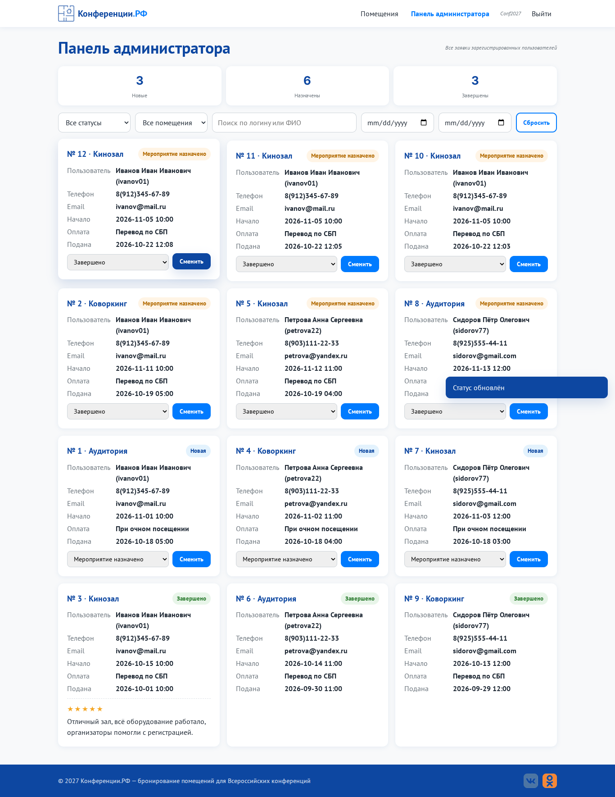
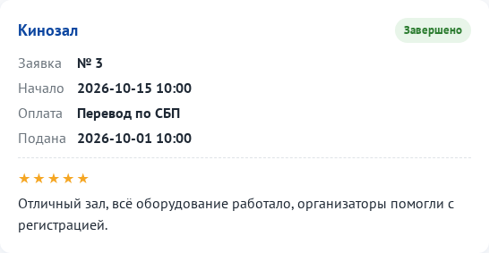
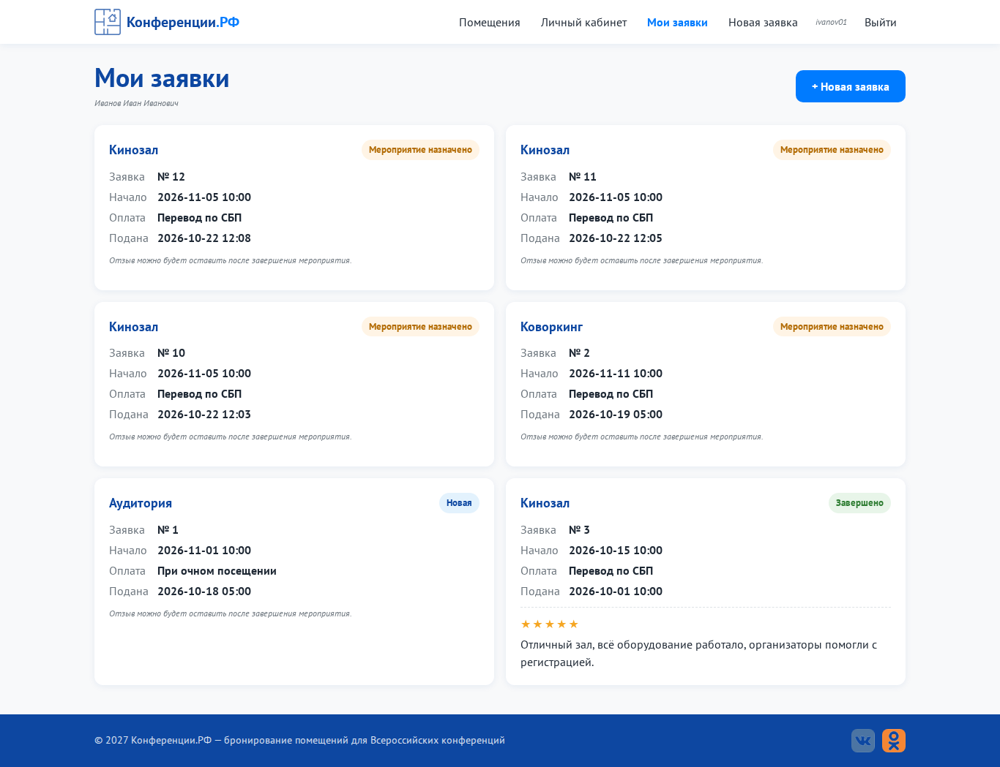
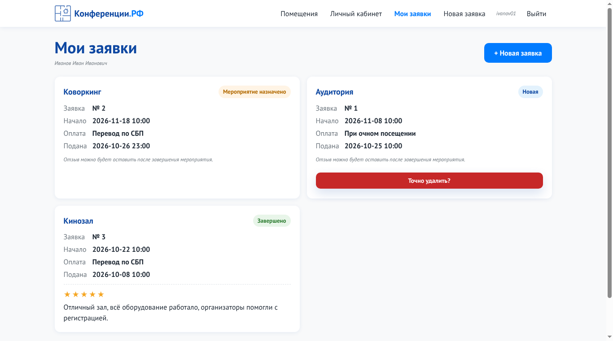
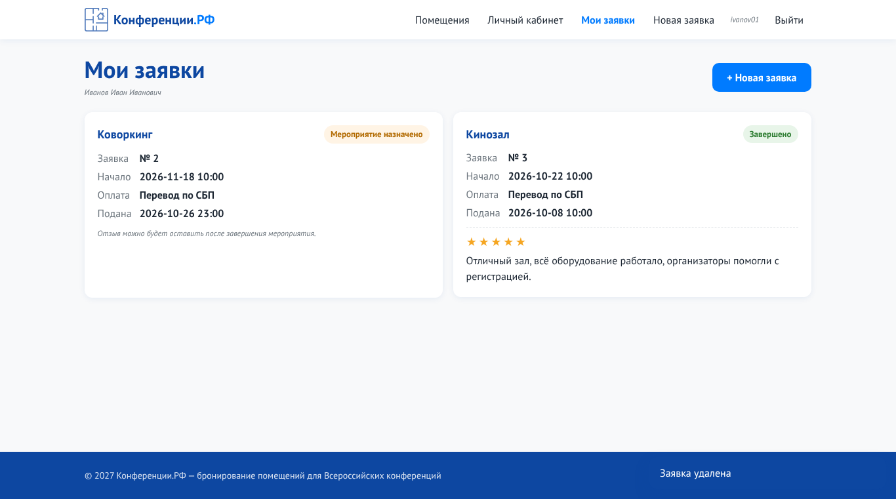

# Практическая работа № 11. Разработка веб-приложения в соответствии с ТЗ

**Цель:** получить работающее приложение с полным функционалом.

## 1. Интеграция фронтенда с бекендом
```
Браузер (JS) ── fetch JSON + X-CSRF-Token ──▶ Flask (routes) ──▶ модели (ООП) ──▶ Database ──▶ SQLite
            ◀────────── JSON {message | errors} ─────────────────────────────────────────────┘
```

## 2. Работа с БД (CRUD)
| Операция | Где | SQL |
|---|---|---|
| **Create** | регистрация, создание заявки, отзыв | `INSERT INTO user / request / review ...` |
| **Read** | мои заявки, все заявки с фильтрами, справочники | `SELECT ... JOIN room, payment_method, status, user LEFT JOIN review` |
| **Update** | смена статуса заявки | `UPDATE request SET status_id = ? WHERE id = ?` |
| **Delete** | участник удаляет свою заявку в статусе «Новая» (кнопка «Удалить заявку», `DELETE /api/requests/<id>`); отзывы и заявки удаляются каскадно вместе с пользователем | `DELETE FROM request WHERE id = ? AND user_id = ?`, `FOREIGN KEY ... ON DELETE CASCADE` |

### Удаление заявки
- Кнопка «Удалить заявку» показывается только у заявок в статусе «Новая». Первое нажатие просит подтверждения («Точно удалить?»), второе удаляет заявку без перезагрузки страницы. Окон браузера нет, подтверждение сбрасывается через 4 секунды.
- Сервер (`Request.delete_own`) повторно проверяет правила: чужая заявка не найдена (404), заявка не в статусе «Новая» не удаляется (409), нужен CSRF-токен и вход участником.
- Проверено тестами `test_delete_own_new_request`, `test_cannot_delete_assigned_request`, `test_cannot_delete_foreign_request`, `test_delete_requires_csrf_and_login`.

## 3. Смена статусов
`Новая → Мероприятие назначено → Завершено`. Статус двигается только вперёд: в карточке админки выпадающий список предлагает только следующие статусы, и сервер (`Request.change_status`) повторно проверяет правило. Попытка вернуть статус назад получает ответ 400.

## 4. Отзывы после завершения
Когда заявка переходит в статус «Завершено», в личном кабинете участника появляется форма отзыва (оценка 1-5 звёздами и текст от 10 символов). После отправки форма без перезагрузки страницы заменяется опубликованным отзывом, и администратор видит отзыв в карточке заявки.

## 5. Полный сценарий (проверен автотестом `test_full_cycle_review_after_done`)
| Шаг | Кто | Результат |
|---|---|---|
| 1 | участник создаёт заявку | статус «Новая» |
| 2 | участник пытается оставить отзыв | отказ: «Отзыв можно оставить только после завершения мероприятия» |
| 3 | администратор → «Мероприятие назначено» | ✅ |
| 4 | администратор повторно устанавливает «Мероприятие назначено» | 400: «Статус можно менять только вперёд» |
| 5 | администратор → «Завершено» | ✅ |
| 6 | участник оставляет отзыв | ✅, отзыв виден участнику и администратору |
| 7 | повторный отзыв | отказ: «Отзыв по этой заявке уже оставлен» |

## Смена статуса


## Опубликованный отзыв у завершённой заявки


## Мои заявки с опубликованным отзывом


## Код и запуск
Приложение целиком лежит в папке [`code/`](code). Запуск (**cmd**, из корня репозитория):
```bash
cd ПР11_Веб-приложение_по_ТЗ\code
python -m venv venv
venv\Scripts\activate          # Linux: source venv/bin/activate
pip install -r requirements.txt
python seed_demo.py            # тестовые данные
python run.py                  # http://127.0.0.1:5000
```
Администратор: **Conf2027 / Demo77**, участник: **ivanov01 / Password1**. Тесты: `pip install pytest`, затем `python -m pytest -q tests`.

## Удаление заявки
| Подтверждение | После удаления |
|---|---|
|  |  |
